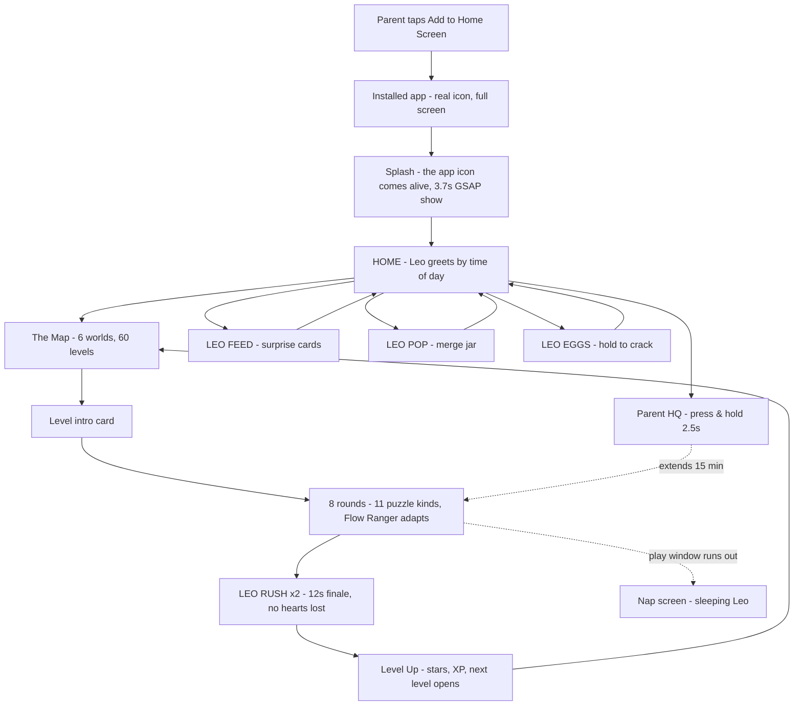

# Think Leo — End to End

> The whole product, told as one journey: what happens from the second a
> parent taps **Add to Home Screen** to the second the play window closes and
> Leo falls asleep. Every claim links to the deep-dive book that owns it.

**The bookshelf**

| Book | What it owns |
| --- | --- |
| [`README.md`](../README.md) | The pitch, the stack, how to run it |
| [`ALGORITHM.md`](ALGORITHM.md) | The design research, loops, math and economy (§1–§18) |
| [`ICONS.md`](ICONS.md) | Every icon and glyph, the icon pipeline, the palette |
| [`ANIMATIONS.md`](ANIMATIONS.md) | Every animation: Leo's 9 moods, the splash show, the motion library |
| [`KID-TEST.md`](KID-TEST.md) | The field test that drives the fixes |
| `END-TO-END.md` *(this file)* | How it all connects, in order |

---

## The journey in one picture

---

## 1. Minute zero — install & first light

A parent opens `thinkleo.vercel.app` in a phone browser. Nothing in the UI
ever says "PWA" — the Home screen simply offers **"Add to Home Screen"**.
Installing gives a real Leo icon (`public/icons/` — see
[`ICONS.md`](ICONS.md)), a full-screen standalone app with safe-area padding,
and a service worker (`public/sw.js`, v8) that precaches the shell, icons and
the three music tracks.

**First light is a show, not a spinner.** The splash replays the home-screen
moment: the icon card drops in with an elastic wobble, the wordmark pops
letter by letter, a parade of world friends marches, paw prints fill as the
loading beat, a star bursts with a fanfare, the curtain lifts. Underneath,
the splash is silently doing a real job — it is the **hydration cover**, so
the app never flashes a half-loaded save. Beat-by-beat:
[`ANIMATIONS.md` §3](ANIMATIONS.md#3-the-startup-show-gsap-37-s-once-per-session).
Then a **first-run tour** (v9) plays once: four bottom-sheet beats where Leo
introduces the map, the arcade doors and the daily flame — skippable, and
never seen again (`tourDone`).

## 2. Home — the hub

One warm screen, zero reading required, owned by the kid:

- **Leo** greets by time of day (morning/afternoon/evening lines in
  `game.ts` `LEO_LINES`), tapping him cycles moods and sounds.
- **Today's rings:** the daily-goal XP ring (goal 120 XP) and the **streak
  flame** with milestone freezes.
- **The quest board:** 3 daily quests drawn from `QUEST_POOL` (finish levels,
  earn stars, hit Rush streaks…) — the *same board* is fed by the learning
  game and all three arcades, which is what makes one session advance
  everything at once (the Duolingo one-currency trick, [`ALGORITHM.md`
  §1.1](ALGORITHM.md#1-design-research--what-we-copied-and-from-whom)).
- **Three arcade doors:** LEO FEED, LEO POP, LEO EGGS.
- Small **grown-up door** in the corner → Parent HQ (§7).
- If the play window is spent, everything else waits behind the **nap
  screen** — a sleeping Leo (§7).

## 3. The map — six worlds, sixty levels

A Candy-Crush-style winding trail (`LevelMap.tsx`): **6 worlds × 10 levels**
— Jungle Jam, Coral Cove, Space Hop, Candy Peak, Farm Days, Road Rush — each
world with its own colour wash, banner, emblem and chest.

- Nodes show earned stars (0–3); locks show what's coming.
- **Progress is kind:** a level unlocks when the previous one is *finished* —
  any score counts (the "levels always end" guarantee, born from kid-test
  finding #4). The **first level of each world opens after 3 finished levels
  of the previous world** (`WORLD_GATE_DONE = 3`).
- The current node pulses green (`anim-pulse-ring`); the camera auto-scrolls
  to it, and re-aims when the save rehydrates (kid-test fix).
- World chests award refill tickets + XP (`CHEST_REWARDS = 3 refills,
  40 XP`).
- Entering a level fires the **world-coloured wipe** — a 1.25 s full-screen
  moment that makes even "level 23 again" feel like an event.
- The Space Hop world floats in a lazy-loaded three.js starfield.

## 4. Inside a level

**Intro card:** the round plan preview, hearts, and Leo (`excited`) asking
"Ready to think fast?". If hearts are empty: **practice mode** — frozen
hearts, half XP, so no kid is ever hard-stuck. Leo's free **daily courage
boost** (+10 XP head start, `BOOST_XP`) is here too.

**Eight rounds** (`ROUND_COUNT = 8`) drawn from **11 puzzle kinds** in
`questions.ts`: Count · Add & subtract · More or less · Odd one out · What
comes next (number sequences) · True or trap · Times tables · Memory ·
**Tap the Target** (big icons, zero reading) · **Shadow Match** (coloured
answers — kid-test fix) · **Feed Leo** (counting you can feel, with the bowl
overlay only on this kind).

The **Flow Ranger** watches accuracy per skill (`skillStats`) and breathes
difficulty to keep each kid in flow — stronger kids get spicier numbers,
struggling kids get gentler ones and longer timers
([`ALGORITHM.md` §5.2](ALGORITHM.md#5-the-play-loop-scoring-combos-flow-ranger-leo-rush)).

While they play:

- **Hearts:** 5 max, one back every **8 minutes** (`HEART_REGEN_MS`), refill
  tickets from chests; **timeouts on learning levels cost no heart**, and a
  wrong answer never ends the round — it *teaches*: the tapped card shakes
  berry, the right one glows leaf, Leo speaks the puzzle's own hint, and a
  free retry starts with a fresh timer.
- **Combo:** consecutive corrects climb a ×2 → ×3 meter with escalating
  sounds; the heartbeat vignette and a 64 px timer dial (kid-tested size) add
  pressure honestly — and **TIME'S UP!** lands as a big wobbly stamp with its
  own gentle sound, never a silent failure.

**The finale — LEO RUSH ×2:** after round 8, 12 seconds of pure adrenaline:
racing light streaks, Leo pop-jumping, every answer worth double
(`RUSH_BASE = 60` before the ×2) and **no hearts can be lost**. It ends on a
hard stop at 0 — the level *always ends*.

**Level up:** stars pop one by one, XP counts up — **every finished run pays
at least 8 XP** (`xpForRun = 8 + stars×6 + min(16, score/250)`), the next
level unlocks, a chest may open, the quest board ticks, the streak holds. One
`addXp()` call updates the daily ring, weekly league, player level and quest
progress atomically ([`ALGORITHM.md` §6](ALGORITHM.md#6-the-economy)).

## 5. The three arcade doors

Zero maths, pure toy — the "Instagram-brain" rooms, each with honest
mechanics documented in [`ALGORITHM.md` §14–§16](ALGORITHM.md#14-leo-pop--the-merge-arcade-v5):

| Arcade | The loop | The honest part |
| --- | --- | --- |
| **LEO FEED** | An endless stream of mystery cards; tap, watch the unwrap ritual (GSAP, slower for rarer friends), meet one of **16 collectible friends** across **5 rarities** | A **visible pity meter** guarantees progress; a **HEAT meter** charges into a guaranteed MEGA card; a **free daily MEGA gift**; the feed learns favourite friends via an affinity table |
| **LEO POP** | Drop friends into a physics jar (matter-js), fuse two of a kind up a merge chain, chase the **Golden Leo**; a **10-creature Zoo Book** to complete | No currency, no timers — it's a toy box, not a store |
| **LEO EGGS** | Pick an egg, **press and hold**, watch the three.js egg shake, crack and burst; **13 friends** across 5 rarities, an album and a room | **Streak-powered luck** (showing up pays), a visible pity meter, a golden near-miss tease, and a **real-time nest that keeps incubating after the app closes** |

## 6. The retention fabric

Everything feeds everything, from one XP source:

1. **Daily goal ring** — 120 XP, visible from Home.
2. **Streak flame** — daily-play streak with **milestone freezes** so one
   sick day doesn't kill a month of showing up; **comeback gifts** welcome
   kids back.
3. **Weekly league** — 6 cosmetic tiers (Sprout 🌱 → Trophy 🏆, drawn as
   ribboned badges, never emoji), ranked by the week's XP.
4. **Quests** — a shared daily board across the learning game *and* the three
   arcades; all-done bonus: +20 XP and a heart refill.
5. **Achievements** — e.g. **Rush Ace** (12 hits in one LEO RUSH) with XP
   rewards and toast ceremonies.

The retention math and psychology per mechanic:
[`ALGORITHM.md` §1, §6, §13](ALGORITHM.md#1-design-research--what-we-copied-and-from-whom).

## 7. Parent HQ — the grown-up side of the door (v8)

Kids own the game; this room belongs to the adult — so the **entrance is a
gate**: press-and-hold the paw for ~2.5 s (a 4-year-old taps; holding is
hard). Four panels, zero jargon:

- **TODAY** — minutes played against the family window, XP, streak, levels
  finished.
- **SKILLS** — per-puzzle mastery bars straight from the Flow Ranger data
  ("counting: strong, times tables: wobbly"), **grouped under the four CBC
  Mathematical Activities strands** (Pre-Number Activities · Numbers ·
  Measurement · Geometry — measurement and geometry show as "coming").
- **CONTROLS** — the daily play window (**15 / 30 / 60 min or open-ended**),
  a **+15 min extension**, sound and music toggles, and a hold-gated **reset**.
- **SAVE CODE** — copy a portable code with the kid's whole progress, paste
  it into Parent HQ on a new device behind a hold gate; stars, streak and
  collections move house. Nothing leaves the devices
  ([`ALGORITHM.md` §19](ALGORITHM.md#19-v9--the-family-release-save-codes-the-first-run-tour-cbc-strands)).

When the window runs out, the whole app flips to the **nap screen**: Leo
asleep, zzz drifting, day done — a boundary that feels like bedtime, not a
paywall. Extensions are a grown-up choice, made in one hold.

## 8. Under the hood

| Layer | How it works |
| --- | --- |
| **Stack** | Next.js 16 (App Router) · TypeScript 5 · Tailwind 4 · framer-motion · GSAP · three.js · matter-js · zustand (persisted save) · Web Audio API · sharp (icons) |
| **Save** | One zustand store persisted to `localStorage` — **no accounts, no cloud, no tracking of the child**; the splash covers rehydration; the map camera re-aims after it lands |
| **Privacy** | The only server touch is an anonymous device-visit log (`/api/device`) so parents can see the app is alive — never any child data |
| **Sound** | A fully synthesized SFX studio (correct/wrong voices, combo climbs, ticks, cracks, roars, `timeUp()`) plus three licensed Kevin MacLeod tracks that crossfade and duck under SFX like a DJ ([`ALGORITHM.md` §8](ALGORITHM.md#8-the-sound-engine-all-synthesized)) |
| **Offline** | SW v7: **network-first for code and navigations** (devices always get the newest build online; the cache is only the offline fallback — the v4 staleness lesson, §17), cache-first for immutable icons/audio; `SKIP_WAITING` + `clients.claim()` auto-update installed apps. The game fully boots and sounds right in airplane mode |
| **Icons** | Generated from one parametric Leo head by `scripts/make-icons.mjs` — pipeline in [`ICONS.md`](ICONS.md) |
| **Deploy** | Push to `main` → Vercel auto-deploys; the SW version string is the update channel kids' devices receive. (Field lesson: force-pushes don't trigger deploys — recorded in [`KID-TEST.md`](KID-TEST.md)) |

## 9. How it stays honest

- **Four simulation suites** run the rules without a browser: `sim-v4.ts`
  (unlocks, question factory, practice guarantee), `sim-feed.ts` (rarity
  table, pity, MEGA, affinity, streak luck), `sim-store.ts` (levels always
  end, streaks always record, feed economy), `sim-savecode.ts` (the save
  codec: round-trip, line-wrap, tamper and garbage proof).
- **Kid-brain field testing** on the *live* deployment with a real browser at
  phone viewport — tap the shiniest thing, answer wrong on purpose, freeze
  under pressure, go offline. Findings and the fixes shipped the same day:
  [`KID-TEST.md`](KID-TEST.md).

---

*Start reading deeper: the loops in [`ALGORITHM.md`](ALGORITHM.md), the pixels
in [`ICONS.md`](ICONS.md), the motion in [`ANIMATIONS.md`](ANIMATIONS.md).*
