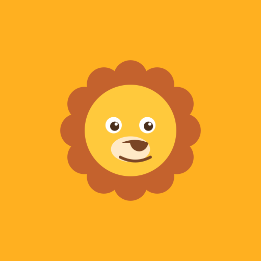
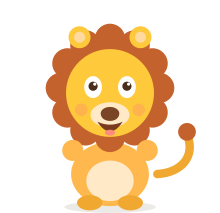
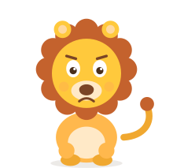
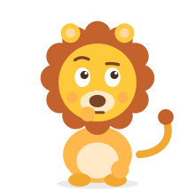
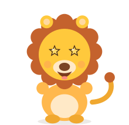

# Think Leo — The Icon Book

> Every glyph in Think Leo is drawn by us, in code: the app icons are
> generated PNGs of Leo's face, and everything inside the app is parametric
> SVG — **not one emoji anywhere** (a kid-tested rule, see
> [`KID-TEST.md`](KID-TEST.md)). This book catalogues every icon, where it
> lives, and how to regenerate it.

---

## 1. The app icons (the PWA set)

Five PNGs, all renders of the same parametric Leo head, generated by
`scripts/make-icons.mjs` with **sharp** — no design tool, no image assets to
lose. Regenerate any time:

```bash
bun scripts/make-icons.mjs
```

### The gallery — the actual files shipped in `public/icons/`

| File | Size | Purpose |
| --- | --- | --- |
|  | 192×192 | Android / desktop install icon (`purpose: any`) |
|  | 512×512 | High-density install icon, splash fallback (`purpose: any`) |
|  | 512×512 | **Maskable** — head drawn at 68 % scale so Android's circular crop never clips the mane |
|  | 180×180 | iOS "Add to Home Screen" icon |
|  | 32×32 | Browser tab favicon |

### How Leo's face is drawn (`leoIconSvg()`)

The generator is one function that returns an SVG string; sharp rasterises it.
Geometry, all on a 1000×1000 canvas on a warm rounded square (`#FFB020`,
corner radius 220):

| Part | Construction |
| --- | --- |
| **Mane** | A centre disc (r = 300·scale) + a ring of **12 circles** (r = 96·scale) at 30° intervals — the same construction as the in-app mascot, so icon and mascot are unmistakably the same lion |
| **Face** | One circle (r = 258·scale, `#FFC93C`) |
| **Eyes** | Two white ellipses (r = 46·scale) with brown pupils (r = 26·scale) offset +6·scale down-right, plus a white shine dot up-right — Leo always looks slightly bright-eyed |
| **Muzzle** | Cream ellipse (110×72·scale, `#FFE9C7`) |
| **Nose** | A rounded triangle path (`#7A4526`) built from two quadratic curves |
| **Smile** | A single quadratic stroke (16·scale wide, round cap) |

Two scale factors matter:

- **0.86** — standard icons: the head fills most of the canvas.
- **0.68** — the maskable icon: Android crops maskable icons to a circle and
  only guarantees a central **safe zone** (~80 % of the canvas). Drawing at
  68 % with a full-bleed square background (`rx="0"`) means the crop can never
  clip mane or ears.

### Where each icon is wired

| Consumer | What it references |
| --- | --- |
| `public/manifest.webmanifest` | `icons[]`: 192 + 512 (`any`), maskable-512, apple-touch — this is what "Add to Home Screen" installs |
| `src/app/layout.tsx` metadata | `icons.icon` (192, 512), `icons.apple`, `themeColor #FFB020`, `appleWebApp` standalone mode |
| `public/sw.js` (v7) | Precaches the icon files, so an offline boot still has a full app icon |

---

## 2. Leo himself — the living logo

Leo is not an image at all. `src/components/leo/Leo.tsx` draws him as
**parametric SVG** (12-circle mane ring, face disc, ears, muzzle, tail) and
framer-motion animates him through **9 moods** — idle, happy, excited, sad,
thinking, celebrate, wow, cheer, sleep. He is the logo (bottom-right of the
splash parade, next to the wordmark on Home), the coach (speech bubbles), and
the emotional scoreboard of the whole game.

| | | |
| --- | --- | --- |
|  |  |  |
|  |  |  |
|  |  |  |

*All nine files are generated from the real component by
`bun scripts/docs-mood-gallery.tsx` into `docs/assets/` — what you see above
is the shipped mascot, not concept art.*

Every mood, blink, tail-wag and bob parameter is catalogued in
[`ANIMATIONS.md`](ANIMATIONS.md) §2.

The **wordmark** (`Logo` component) is Leo (mood `happy`, gently wiggling)
beside "Think **Leo!**" — "Think" in cocoa ink, "Leo!" in the sun→berry→grape
gradient, the only gradient text in the app.

---

## 3. The sticker pack — the game's own art supply

`src/components/leo/stickers.tsx` defines **55 parametric SVG stickers** — the
animals and objects that appear as parade marchers, answer buttons, Feed Leo
bowls, shadow-match casts, LEO POP creatures, egg friends and album art. One
shared drawing grammar: flat fills, 3 px cocoa outline (`#4A2F1B`), round
joins, no gradients — so any two stickers read as siblings.

| Pack | Stickers |
| --- | --- |
| Jungle | monkey · parrot · elephant · butterfly · flower |
| Sea | fish · octopus · crab · dolphin · shell |
| Space | star · rocket · ufo · moon · comet |
| Candy | candy · lollipop · cupcake · donut · cookie |
| Fruit | apple · banana · grapes · strawberry |
| Veggies | carrot · broccoli · corn · chili |
| Pets | dog · cat · rabbit · mouse |
| Woodland *(v4 — the shadow-match cast)* | frog · fox · owl |
| Farm | cow · pig · chicken · sheep |
| Bugs | bee · ladybug · snail |
| Road | car · bus · tractor |
| LEO POP finale *(v5)* | lion — the golden merge-chain end |

`<Sticker id="monkey" size={52} />` renders any of them at any size, with an
optional pop-in animation (`animateIn`) used on answer buttons and album
unlocks.

---

## 4. HUD glyphs & reward art

**HUD glyphs** are [lucide](https://lucide.dev) icons — chunky, rounded, and
the one place we use a library instead of hand-drawn SVG. Imported in
`src/components/game/bits.tsx`: `Brain, Crown, Egg, Flame, Gem, Gift, Hand,
Heart, Map, Medal, Moon, Music, Plus, Rocket, Scale, Search, Shapes, Sparkles,
Star, Target, Timer, Trophy, Volume2, VolumeX, X, Zap` — hearts, the streak
flame, the XP star, quest marks, sound toggles, close buttons. Rule of thumb:
**lucide = interface**, **stickers = game content**, **Leo = emotion**.

**Reward art** (`src/components/leo/badges.tsx`), same sticker grammar:

| Piece | States |
| --- | --- |
| `LeagueBadge` | weekly-league medals: `sprout` 🌱 → `bronze` → `silver` → `gold` → `gem` → `trophy` (ribboned discs, no emoji — drawn ribbons) |
| `ChestArt` | world chest: `locked` → `ready` (glowing) → `open` |
| `Sparkle` / `StarPop` | celebratory marks around Leo and the wordmark |

---

## 5. The palette every icon draws from

Defined once as CSS custom properties in `src/app/globals.css` (`@theme`),
consumed as Tailwind `leo-*` classes:

| Token | Hex | Used for |
| --- | --- | --- |
| `leo-sun` | `#FFB020` | app-icon background, primary brand, theme colour |
| `leo-sun-deep` | `#E08C00` | pressed states, star outlines |
| `leo-honey` | `#FFC93C` | Leo's face, warm fills |
| `leo-leaf` / `-deep` | `#58CC02` / `#3F9A00` | correct answers, go buttons |
| `leo-berry` / `-deep` | `#FF5A8C` / `#D63A6C` | wrong answers, TIME'S UP, low-time ring |
| `leo-grape` / `-deep` | `#9B5DE5` / `#7A3FC4` | wordmark gradient, rarities |
| `leo-teal` / `-deep` | `#2EC4B6` / `#1E9E92` | info, secondary buttons |
| `leo-ink` / `-soft` | `#4A2F1B` / `#8A6A4F` | all outlines & text (one ink family) |
| `leo-cream` / `-paper` / `-sand` / `-line` | `#FFF7E6` / `#FFFDF7` / `#F7ECD4` / `#F0E0BD` | backgrounds and card borders |

No dark mode — a deliberate choice: kids' apps read best on warm paper, and
one palette keeps every icon on-brand.

---

## 6. The icon rules (so it stays coherent)

1. **No emoji, ever.** Emojis render differently per device and leak
   third-party art into the brand; the kid test confirmed stickers read
   better at 52 px than emoji ever did.
2. **One ink.** Every outline is `#4A2F1B` cocoa at 2–3 px with round joins —
   that's what makes 55 stickers + badges + Leo look like one family.
3. **Leo's face is the logo.** App icon, favicon, splash icon-card and
   wordmark are all the same parametric construction — regenerate the icons
   and they still match the in-app lion exactly.
4. **Interface ≠ content ≠ emotion.** Lucide glyphs for UI chrome, stickers
   for game objects, Leo for feelings. Never mix the jobs.
5. **Icons must survive cropping.** Maskable at 68 %, favicon legible at
   32 px, answer stickers legible at 52 px — tested at kid thumb distance.
